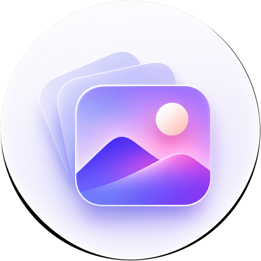

<div align="center">



# Mikasa Gallery — AMOLED Pitch Black & Onyx Yellow Edition

**A 100% offline, privacy-first Android Gallery engineered with Pure AMOLED Pitch Black (`#000000`), Solar/Onyx Yellow (`#FFD600`), and YTX 3-Layer Refractive Liquid Glass Navigation.**

[](https://github.com/xboyrex/Mikasa-Gallery/actions)
[](https://github.com/xboyrex/Mikasa-Gallery/releases)
[](https://kotlinlang.org)
[](https://developer.android.com/jetpack/compose)
[](LICENSE)

</div>

---

## ✨ Key Highlights

### 1. Exclusive AMOLED Pure Pitch Black & Onyx Yellow Design (`#000000` + `#FFD600`)
- **Zero Compromise OLED Contrast**: Locked 100% to true `#000000` pitch-black backgrounds, `#0B0B0E` elevated carbon cards, `#24242C` precision hairlines, and `#FFD600` / `#FACC15` Solar Yellow accents.
- **No Unwanted Theme Clutter**: All light themes and non-yellow color modes have been stripped out so every screen, dialog, bottom sheet, PIN lock screen, and widget renders in pure black and yellow.
- **Custom Geometric Iris Aperture Icons**: High-density adaptive, round, and legacy launcher icons (`mdpi` through `xxxhdpi`) with a dark iris lens and glowing `#FFD600` aperture blades on a `#000000` background.

### 2. YTX 3-Layer Refractive Liquid Glass Navigation Bar
- **Real-Time Backdrop Refraction**: Powered by `io.github.kyant0:backdrop:2.0.1` (`rememberLayerBackdrop` + `drawBackdrop`) with chromatic aberration, barrel lens refraction (`14.dp` × `28.dp`), and vibrant saturation boost.
- **Floating Lifted Architecture**: Lifted cleanly above the system navigation bar (`18 dp` default, customizable from `6 dp` to `42 dp` in Settings) so it floats over your photo timeline.
- **Interactive Drag & Velocity Physics**: Supports both tap-to-switch and continuous horizontal drag-to-switch (`DampedDragAnimation`) with spring stretch deformation, touch-tracking specular glow (`InteractiveHighlight`), and crisp haptic ticks (`HapticFeedbackConstants.CLOCK_TICK`).

### 3. Smooth App Open, Close & Screen Transition Animations
- **Activity Launch & Exit Transitions**: Custom spring-like scale + fade XML animations (`res/anim/app_open_enter.xml`, `app_open_exit.xml`, `app_close_enter.xml`, `app_close_exit.xml`) wired via Android 14+ `overrideActivityTransition` and legacy `overridePendingTransition`.
- **Compose Root Entrance Animation**: Smooth spring scale (`0.94f -> 1.0f`) and alpha fade-in on app startup.
- **Spring Screen Transitions**: Fluid `AnimatedVisibility` and `AnimatedContent` spring transitions when opening and closing `PhotoViewer`, `Albums` detail grids, `EditorScreen`, `SettingsScreen`, and `AboutScreen`.

### 4. Complete Offline Gallery & Pro Media Toolkit
- **Hardware-Accelerated Photo & Video Engine**: Powered by **Coil 3** (with sub-sampled zoomable views, GIF, WebP, SVG, HEIF, and RAW support) and **AndroidX Media3 ExoPlayer** (with double-tap zoom, swipe gestures for volume/brightness/seeking, and frame-accurate scrubbing).
- **Built-In Photo Editor & Exif Studio**: Crop, rotate, flip, apply filters, and edit or strip EXIF metadata and GPS coordinates before sharing (`Secure Sharing Mode`).
- **Biometric & PIN Locked Vault**: Move sensitive photos and videos into an encrypted private vault protected by Fingerprint/Biometric unlock and a 4–6 digit PIN keypad with lockout protection.
- **Smart Duplicate Scanner, Memories & Folder Browser**: Perceptual hash (`dHash`) duplicate finder, On-This-Day Memories, direct filesystem Folder Browser, and customizable 15-language localization.

---

## 🚀 Starting Fresh from Termux (One-Command Repo Creation & Push)

This project includes `create_repo_termux.sh` to initialize a brand-new Git repository, create the repo on GitHub, and push both `main` and tag `v1.0.0` (which automatically triggers GitHub Actions to build and publish your signed Release APK):

```bash
# 1. Unzip the project in Termux
unzip Mikasa-Gallery-main.zip -d Mikasa-Gallery
cd Mikasa-Gallery

# 2. Run the automated Termux repo creation & push script
chmod +x create_repo_termux.sh
./create_repo_termux.sh
```

Or pass your GitHub token inline without interactive prompts:

```bash
GITHUB_USER="xboyrex" REPO_NAME="Mikasa-Gallery" GITHUB_TOKEN="ghp_your_token_here" ./create_repo_termux.sh
```

---

## 🛠️ Building Locally (Termux / Linux / macOS / Windows)

- **GitHub Actions CI/CD**: Every push to `main` (`.github/workflows/build.yml`) and every `v*` tag push (`.github/workflows/release.yml`) automatically builds signed Release and Debug APKs on `ubuntu-latest` (JDK 21 + Gradle 9.7.1) and publishes them to **GitHub Releases**.
- **Local / Termux Build**:
  ```bash
  chmod +x deploy.sh
  ./deploy.sh
  ```
  *(Note: `deploy.sh` automatically detects if it is running inside Android Termux and passes `-Pandroid.aapt2FromMavenOverride=/data/data/com.termux/files/usr/bin/aapt2` only when present on device, keeping standard CI and desktop builds 100% clean.)*

---

## 👨‍💻 Developer & Community

- **Developer**: [Mayank (`@xboyrex`)](https://github.com/xboyrex)
- **GitHub Repository**: [github.com/xboyrex/Mikasa-Gallery](https://github.com/xboyrex/Mikasa-Gallery)
- **Telegram Channels**: [@MayankDroid7](https://t.me/MayankDroid7) • [@OnyxHub7](https://t.me/OnyxHub7)
- **YouTube**: [@mayankdroid](https://youtube.com/@mayankdroid?si=slX8DDU0dpLSIYyY) • [@onyxdroid89](https://youtube.com/@onyxdroid89?si=9gxpZfa3bpI9PKku)
- **Instagram**: [@mayank.zx7](https://www.instagram.com/mayank.zx7)
- **Contact Email**: [xboyrex496@gmail.com](mailto:xboyrex496@gmail.com)

---

## 📄 License

Licensed under the [Apache License 2.0](LICENSE).
